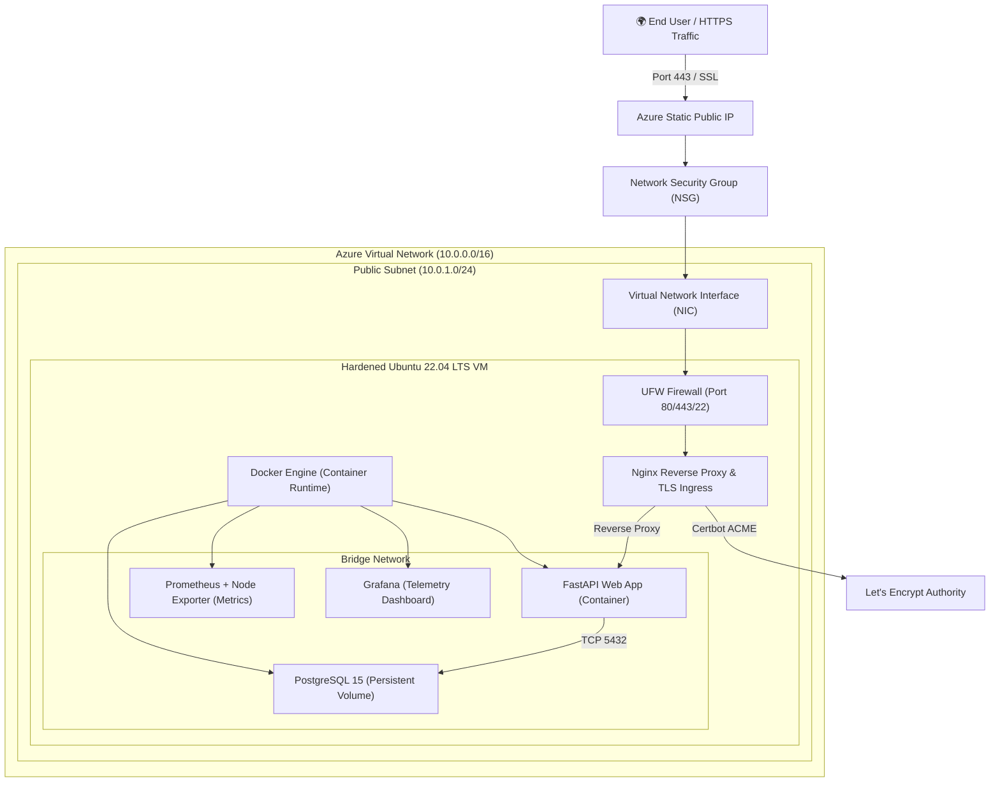

# 🌐 Enterprise Azure VM Infrastructure & Containerized Application Deployment

[](https://github.com/shrutibawase/azure-vm-app-deployment/releases)
[](https://www.terraform.io/)
[](https://azure.microsoft.com/)
[](https://fastapi.tiangolo.com/)
[](https://www.postgresql.org/)
[](https://www.docker.com/)
[](https://nginx.org/)
[](https://prometheus.io/)
[](https://grafana.com/)
[](https://github.com/features/actions)
[](LICENSE)

An end-to-end, enterprise-ready infrastructure and continuous delivery ecosystem deployed on **Microsoft Azure**. Features secure Virtual Network topology, hardened Linux VM compute, containerized web microservices, automated Let's Encrypt SSL certificates, Prometheus & Grafana telemetry, and automated GitOps CI/CD pipelines.

---

## 🏛 System Architecture



---

## 📚 Complete Technical Documentation

| Documentation Guide | Focus Area & Deliverables |
|---|---|
| 📖 [**End-to-End Walkthrough**](docs/deployment-walkthrough.md) | Complete step-by-step tutorial: prerequisites, Azure login, and deployment. |
| 🏗 [**Architecture Specification**](docs/architecture.md) | Network topology, address allocation, NSG firewall rules, and compute design. |
| 🛡 [**VM Hardening Guide**](docs/vm-hardening-guide.md) | Cloud-Init bootstrap, UFW firewall, Fail2Ban brute force defense, and SSH keys. |
| 🔌 [**API Schema & Developer Guide**](docs/api-guide.md) | RESTful API endpoints, Pydantic schemas, Swagger UI, and unit test fixtures. |
| 🌐 [**Reverse Proxy & SSL Guide**](docs/reverse-proxy-guide.md) | Nginx upstream pooling, rate limiting, security headers, and Let's Encrypt ACME. |
| 🚀 [**CI/CD Pipeline Guide**](docs/cicd-pipeline-guide.md) | GitHub Actions workflows, GHCR container publishing, and zero-downtime SSH deploy. |
| 🚨 [**Production Runbook**](docs/RUNBOOK.md) | Incident triage checklist, disaster recovery database restore, and monitoring stack. |
| ⚡ [**Benchmark Analysis**](docs/benchmark-report.md) | Stress testing, latency SLA benchmarks, and rate limiter verification under load. |

---

## 🗂 Directory Structure

```plaintext
azure-vm-app-deployment/
├── .github/
│   ├── workflows/              # GitHub Actions CI/CD pipelines (Lint, Test, Build, Deploy)
│   └── README.md               # GitHub Actions & secrets setup guide
├── app/                        # FastAPI RESTful application source & tests
│   ├── crud.py                 # Database CRUD business logic
│   ├── database.py             # SQLAlchemy 2.0 connection pool
│   ├── Dockerfile              # Multi-stage container build (UID 10001)
│   ├── main.py                 # FastAPI application & health probes
│   ├── models.py               # Database ORM models
│   ├── routes.py               # API v1 routes & endpoints
│   └── schemas.py              # Pydantic validation schemas
├── docs/                       # Technical runbooks and architecture specifications
├── monitoring/                 # Observability stack (Prometheus, Grafana, Node Exporter)
│   ├── alert_rules.yml         # Prometheus alert triggers
│   ├── docker-compose.monitoring.yml # Monitoring stack orchestration
│   ├── fail2ban/               # Host intrusion defense configuration
│   └── grafana/                # Pre-configured Grafana telemetry dashboard
├── nginx/                      # Nginx reverse proxy configuration, rate limiting & SSL
├── scripts/                    # Operational automation (bootstrap, deploy, backup, restore)
├── terraform/                  # Infrastructure as Code (IaC) modules
│   ├── compute.tf              # Ubuntu 22.04 LTS Linux VM
│   ├── main.tf                 # Resource Group, VNet, Subnet
│   ├── network.tf              # Static Public IP & Network Interface
│   ├── outputs.tf              # Connection strings and IP addresses
│   ├── providers.tf            # AzureRM & TLS providers
│   ├── security.tf             # Network Security Group (NSG) rules
│   ├── ssh.tf                  # Automated 4096-bit RSA SSH keypair
│   └── variables.tf            # Configurable parameters & validation
├── docker-compose.yml          # Local container development stack
├── docker-compose.prod.yml     # Production container stack with Certbot
├── CHANGELOG.md                # Project release history
├── LICENSE                     # MIT License
└── README.md                   # Project documentation
```

---

## ⚡ Quickstart Commands

### 1. Provision Infrastructure
```bash
# Authenticate to Azure
az login

# Deploy all Azure cloud resources
./scripts/bootstrap.sh
```

### 2. Connect to Provisioned Host
```bash
./scripts/connect-vm.sh
```

### 3. Deploy Application Stack
```bash
# Local testing
docker compose up -d

# Production deployment with SSL
./scripts/deploy.sh
```

### 4. Teardown & Clean Resources
```bash
./scripts/destroy.sh
```

---

## 👤 Author & Maintainer

Architected & Developed by **[Shruti Bawase](https://github.com/shrutibawase)**  
*DevSecOps & Cloud Infrastructure Engineer*
