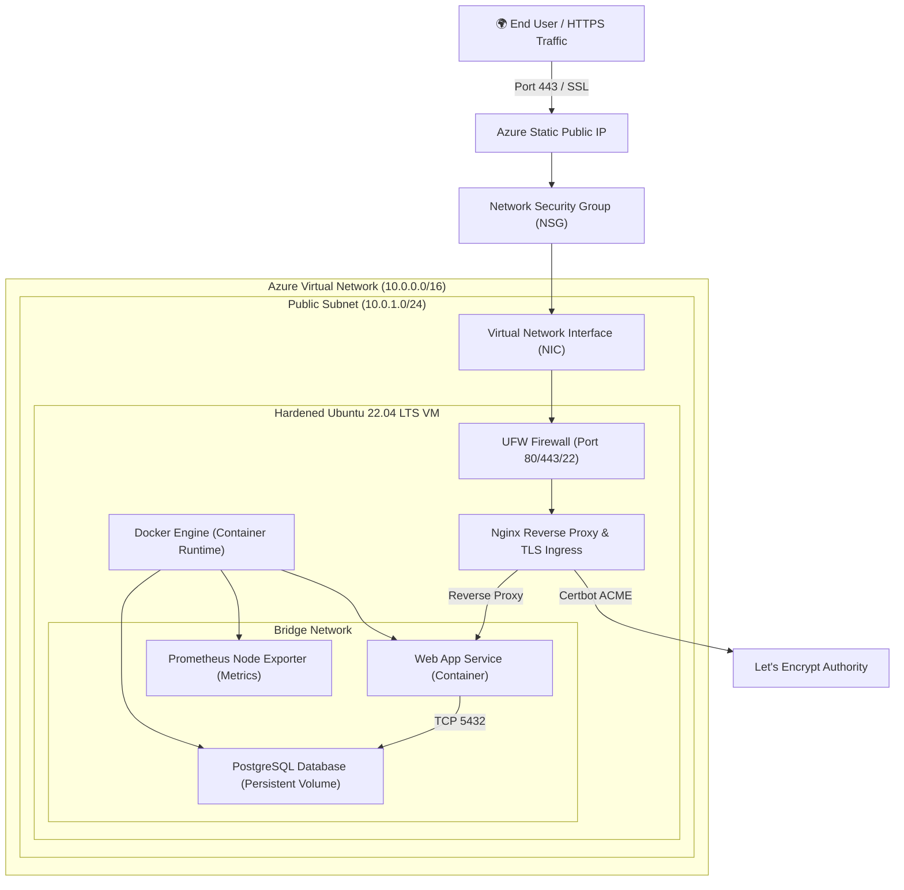

# 🌐 Enterprise Azure VM Infrastructure & Containerized Application Deployment

[](https://www.terraform.io/)
[](https://azure.microsoft.com/)
[](https://fastapi.tiangolo.com/)
[](https://www.postgresql.org/)
[](https://www.docker.com/)
[](https://nginx.org/)
[](https://github.com/features/actions)
[](LICENSE)

An end-to-end, production-grade infrastructure and continuous delivery ecosystem deployed on **Microsoft Azure**. Provisions secure Virtual Network topology, hardened Linux VM compute, containerized web microservices, automated TLS/SSL certificate issuance, and GitOps CI/CD pipelines.

---

## 🏛 System Architecture



---

## 🗂 Directory Structure

```plaintext
azure-vm-app-deployment/
├── .github/
│   └── workflows/              # GitHub Actions CI/CD pipelines
├── app/                        # Containerized application source & tests
│   ├── Dockerfile              # Multi-stage container build
│   └── docker-compose.yml      # Local and testing container orchestration
├── docs/                       # Architectural specifications and runbooks
│   └── architecture.md         # Detailed infrastructure deep dive
├── nginx/                      # Nginx reverse proxy configuration & SSL certbot
├── scripts/                    # Automation, backup, and deployment scripts
├── terraform/                  # Infrastructure as Code (IaC) modules
│   ├── main.tf                 # Core infrastructure composition
│   ├── variables.tf            # Configurable parameters & validation
│   ├── outputs.tf              # Connection strings and IP addresses
│   ├── providers.tf            # AzureRM provider configuration
│   └── terraform.tfvars.example# Template parameter inputs
├── .editorconfig               # Code style & whitespace conventions
├── .gitignore                  # Git ignore rules for state and credentials
├── .pre-commit-config.yaml     # Pre-commit formatting & security linters
└── README.md                   # Project documentation
```

---

## 🛡 Key Features & Best Practices

1. **Infrastructure as Code (IaC)**: Modular Terraform definitions with explicit dependency graphs and remote-state readiness.
2. **Zero-Trust Network Security**:
   - NSG rules restrict incoming connections strictly to HTTP (`80`), HTTPS (`443`), and SSH (`22`).
   - SSH password authentication is disabled; strict Ed25519 public key authentication enforced.
3. **Automated Provisioning**: Cloud-init bootstrap scripts dynamically install Docker, configure user privileges, and initiate system security updates.
4. **Resilient Container Runtime**: Multi-stage lightweight containers managed via Docker Compose with health checks and volume persistence.
5. **TLS/SSL Encryption**: Automated certificate issuing and renewal via Certbot / Let's Encrypt.
6. **Automated CI/CD**: GitHub Actions pipeline covering linting, test suite execution, container image packaging, and zero-downtime SSH deployment.
