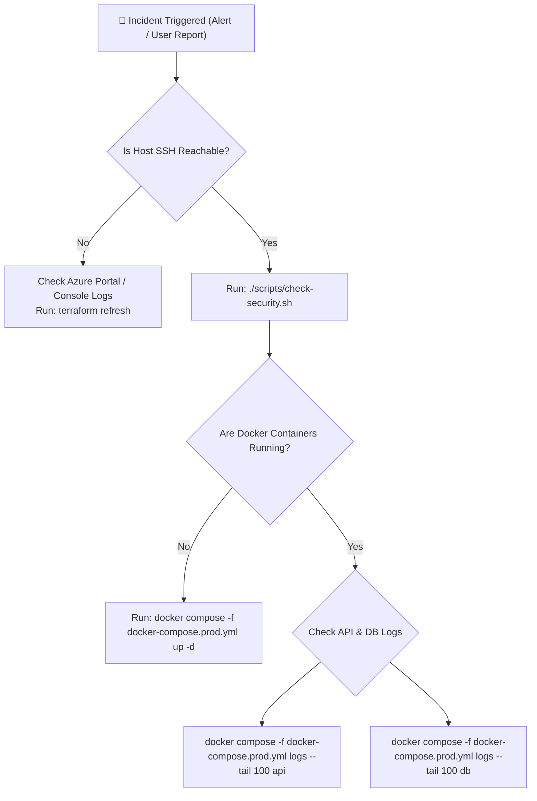

# 🚨 Production Operations & Incident Response Runbook

This runbook outlines emergency operating procedures, disaster recovery protocols, and diagnostic runbooks for the Azure VM deployment.

---

## 🧭 Severity Classifications

| Severity | Definition | Target Resolution | Escalation Path |
|---|---|---|---|
| **P0 (Critical)** | Complete service outage; API returning 5xx or completely unreachable. | < 30 Minutes | On-call DevOps Lead |
| **P1 (High)** | Degraded performance, rate limits triggering unexpectedly, database latency > 1s. | < 2 Hours | Primary Engineer |
| **P2 (Moderate)** | Non-critical component degradation (e.g. metrics dashboard unreachable, backup warning). | Next Business Day | Engineering Team |

---

## 🔍 Triage Checklist



### 1. Check Container Health
Connect to the host VM and run:
```bash
docker compose -f docker-compose.prod.yml ps
```

### 2. Inspect Container Logs
```bash
# Application logs
docker compose -f docker-compose.prod.yml logs -f --tail 100 api

# Database logs
docker compose -f docker-compose.prod.yml logs -f --tail 100 db

# Ingress Nginx logs
docker compose -f docker-compose.prod.yml logs -f --tail 100 nginx
```

---

## 💾 Database Disaster Recovery & Restore

If the database is corrupted or requires rollback to a previous snapshot:

1. Locate the latest backup file:
   ```bash
   ls -la backups/
   ```
2. Execute the automated restore script:
   ```bash
   ./scripts/restore-db.sh backups/db_cloudappdb_20261108_010000.sql.gz --force
   ```
3. Verify table counts and API health:
   ```bash
   ./scripts/smoke-test.sh http://localhost
   ```

---

## 📊 Telemetry Stack (Prometheus & Grafana)

To boot up the monitoring subsystem on the host VM:

```bash
cd monitoring
docker compose -f docker-compose.monitoring.yml up -d
```

- **Prometheus**: `http://localhost:9090` (Scrapes host metrics and API health)
- **Grafana**: `http://localhost:3000` (User: `admin` / Password: `AdminSecurePass123!`)
