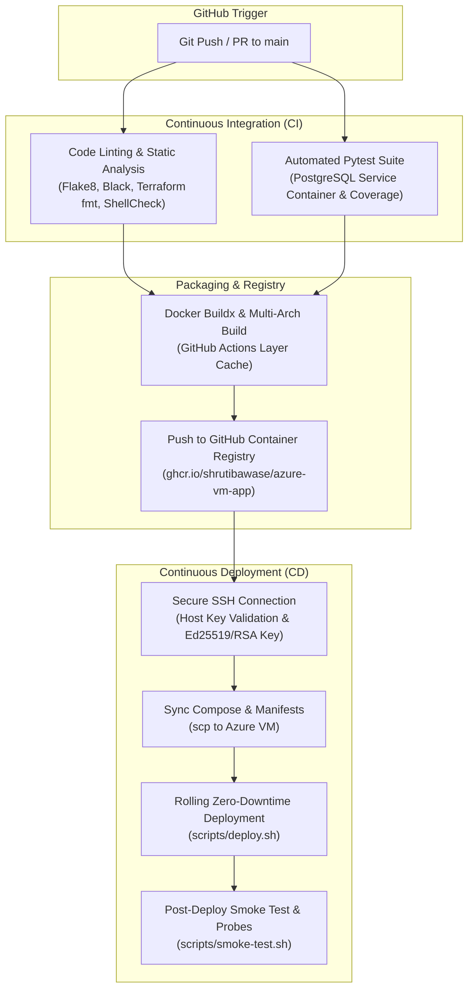

# 🚀 CI/CD Pipeline & GitOps Automation Guide

This document details the multi-stage continuous integration, container publishing, and zero-downtime deployment automation powered by **GitHub Actions**.

---

## 🏛 Pipeline Flow & Architecture

---

## 🔐 Required GitHub Repository Secrets

Configure the following secrets in your repository settings under **Settings > Secrets and variables > Actions**:

| Secret Name | Required | Description | Example / Source |
|---|---|---|---|
| `AZURE_VM_HOST` | **Yes** | Public IPv4 address of the Azure Linux VM | Output from `terraform output public_ip_address` |
| `AZURE_VM_USER` | No | Linux administrative username (defaults to `azureuser`) | `azureuser` |
| `AZURE_VM_SSH_KEY` | **Yes** | Private key (`.pem`) contents for SSH authentication | Content of `terraform/id_rsa_cloudapp-prod.pem` |

---

## 📋 Workflow Manifests

1. **`lint.yml` (Code Quality & Static Analysis)**:
   - Python styling check via `black --check`.
   - Python linting via `flake8`.
   - Terraform syntax validation via `terraform fmt -check` and `terraform validate`.
   - Shell script safety via `shellcheck`.

2. **`test.yml` (Automated Pytest & Integration Tests)**:
   - Boots ephemeral `postgres:15-alpine` container on port 5432.
   - Executes `pytest` with database integration tests.
   - Exports test coverage report artifact (`coverage.xml`).

3. **`build-publish.yml` (Container Build & GHCR Publish)**:
   - Uses `docker/buildx` with GitHub Actions cache (`type=gha`).
   - Automatically tags images with `latest`, Git commit SHA, and release semver tags.
   - Pushes to GitHub Packages (`ghcr.io`).

4. **`cd.yml` (Automated SSH Zero-Downtime Deployment)**:
   - Connects to Azure VM via `ssh-agent`.
   - Synchronizes compose and proxy configurations.
   - Executes rolling container recreation and reloads Nginx.
   - Runs `scripts/smoke-test.sh` to verify live endpoints and triggers automated recovery if failed.
